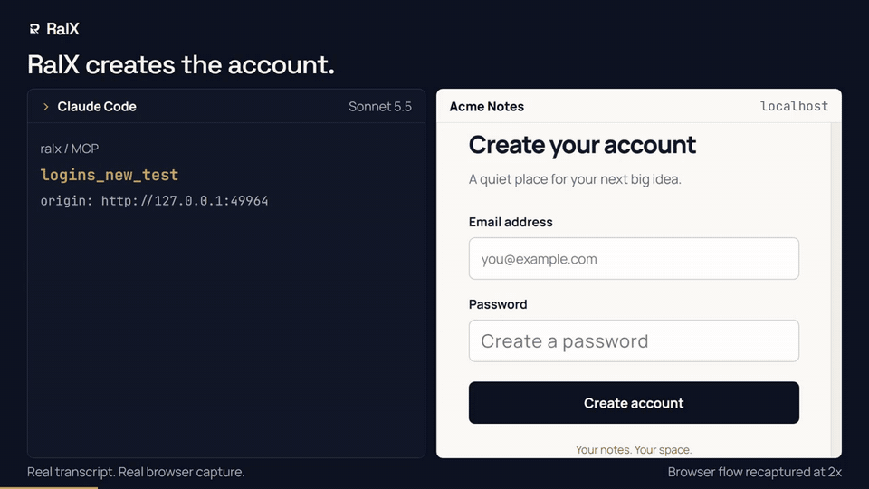
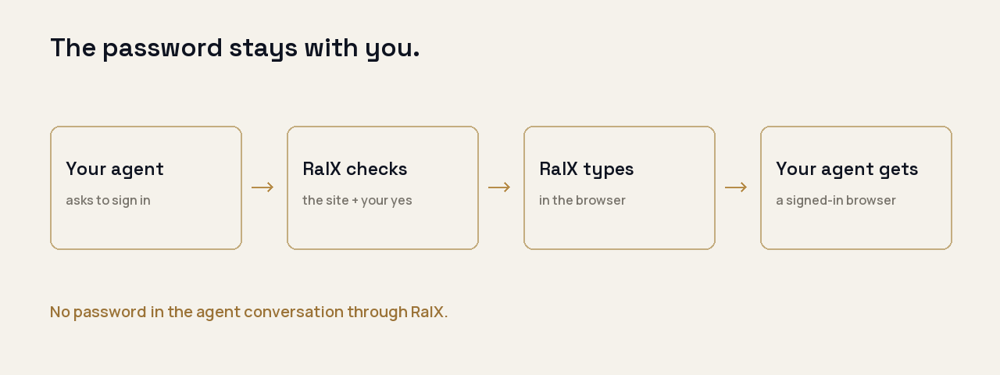

<picture>
  <source media="(prefers-color-scheme: dark)" srcset="docs/images/readme-banner-dark.png">
  <source media="(prefers-color-scheme: light)" srcset="docs/images/readme-banner-light.png">
  
</picture>

# RalX

Connect your tools and logins once. Your agents can use them without receiving your passwords through RalX.

[](https://github.com/Harsette/ralx/releases)
[](https://github.com/Harsette/ralx/actions/workflows/ci.yml)
[](LICENSE)

## Paste this into your agent

```text
Install RalX for me: follow https://github.com/Harsette/ralx/blob/main/AGENT_INSTALL.md
```

Or install from a terminal. macOS / Linux:

```sh
curl -fsSL https://raw.githubusercontent.com/Harsette/ralx/main/install.sh | sh
```

Windows PowerShell:

```powershell
irm https://raw.githubusercontent.com/Harsette/ralx/main/install.ps1 | iex
```

Finish setup in your browser, then restart your agents. [Install and client setup](docs/install.md).

## See it work

[](docs/images/ralx-readme.mp4)

[Watch the full 27-second MP4](docs/images/ralx-readme.mp4). Real tool replies and browser frames from Claude Code on a local demo app.

## What you can do in the first minute

- Connect an account in RalX, then ask your agent to use it.
- Save a website login and ask your agent to sign in. RalX fills and submits the password.
- Switch to another connected agent. The account is already there.

Provider setup and browser approval can take longer than installation. [Website sign-in examples](docs/agent-signin.md).

## Why

You give your agent a job. It asks for a login. You paste a password into a chat, connect the same tool again in another app, then wonder what you just gave away. RalX keeps the login in one place. Your agent asks to use it, gets the result, and carries on. Risky actions wait for your yes.

<picture>
  <source media="(prefers-color-scheme: dark)" srcset="docs/images/how-it-works-dark.png">
  <source media="(prefers-color-scheme: light)" srcset="docs/images/how-it-works-light.png">
  
</picture>

## Works with your agents

Setup connects **Claude Code, Claude Desktop, Codex, Cursor, Antigravity, VS Code, Windsurf and Gemini CLI** automatically. Each gets its own revocable RalX identity. Anything else that speaks MCP can connect with [one snippet](docs/install.md#connected-clients).

Local mode includes website sign-in, GitHub, Vercel, Google / YouTube, Upload-Post and upstream MCP connections. The self-hosted cloud currently has native Gmail and Drive tools. Connect your own provider accounts. [Choose a mode](docs/install.md#choose-where-ralx-runs).

## You stay in charge

- **What agents see:** tools, allowed login names and task results. RalX does not offer agents an API to read the vault. Signed-in pages and returned data can still be private.
- **What waits:** listed risky actions, including sends and deletes, wait for approval of the exact request. Ordinary reads may run automatically.
- **What you can stop:** revoke an agent and its next request fails. A request already sent cannot be recalled.
- **Where secrets live:** encrypted on your computer, or in your Cloudflare database when self-hosting. Programs running as your user can access local files. A cloud administrator controls the database and encryption key.

**The browser caveat:** passwords never enter the agent’s conversation through RalX. An agent with raw browser debugging access to the same page could still read a filled field before submit. Sign-up and sign-in submit immediately to keep that window short. A hostile website can also keep the password you give it. Reply filtering is a backstop, not a guarantee against every disguised secret. [Sign-in limits](docs/agent-signin.md#limits) and [security model](docs/threat-model.md).

## Run it your way

| Where | Start here |
| --- | --- |
| **On your computer** | Free. Choose **This computer** in setup. [Local guide](docs/install.md#this-computer-recommended). |
| **Your own Cloudflare** | Your account, database and keys. Bring your own Google and WorkOS apps. [Self-host guide](docs/self-host.md). |
| **RalX Cloud** | Coming soon. [Join the launch list](https://ralx.ralveto.com/#run). |

## Update, remove, or get unstuck

Rerun the installer to get the latest published release. Keep the same data directory and address. Run `ralx doctor` after setup or an update to check the service and agent connections. It checks configuration and saved status; it does not prove a live provider task succeeded.

```sh
ralx doctor
ralx open
```

`ralx setup --remove` disconnects setup-created agents. `ralx uninstall` also stops the per-user service and removes its binary and startup entry. Vault data and logs are kept. Hosted agent identities also need revoking in that host’s Agents screen. [Removal details](docs/install.md#remove-or-uninstall) and [troubleshooting](docs/install.md).

## Contribute

See [CONTRIBUTING.md](CONTRIBUTING.md). Report security issues privately to [hello@ralveto.com](mailto:hello@ralveto.com); see [SECURITY.md](SECURITY.md).

Apache-2.0. See [LICENSE](LICENSE).

Made by [Hamza](https://byhars.com) at [Ralveto](https://ralveto.com).
